# AlphaNIST: Unofficial Implementation

[](https://arxiv.org/abs/2610.13354)
[](https://alpha-nist.github.io)
[](pyproject.toml)

An **unofficial**, independent PyTorch implementation of **[AlphaNIST: Emergent Assembly Skills from Binary Task Rewards](https://arxiv.org/abs/2610.13354)** (arXiv:2610.13354, NVIDIA Seattle Robotics Lab, Octi Zhang and colleagues): multi-task robot assembly reinforcement learning with PPO, binary task rewards and success-guided reset sampling, in the spirit of the NIST Assembly Task Board. Maintained by [Anuj Zore](https://github.com/ZoreAnuj); unaffiliated with the paper's authors, NVIDIA, the University of Washington, or NIST. The authors have not released official code at the time of writing; see the [project page](https://alpha-nist.github.io) for their videos.

The learning core runs independently of the simulator. Full simulation uses the robot and task assets described in [setup](docs/setup.md).

[Setup](docs/setup.md) · [Training and evaluation](docs/training.md) · [Provenance and acknowledgments](docs/provenance.md) · [Citation](CITATION.bib)

## Research scope

The implementation combines point-cloud observations, separate actor and critic networks, PPO, success-guided reset sampling, and physics-validated reset banks. The current experimental setting uses a six-axis UR7e with a parallel-jaw gripper and ten industrial assembly tasks. Newton/MuJoCo-Warp advances physics; Isaac Sim renders scene and recorded-state previews. A second campaign on the NIST Assembly Task Board 1 with a Franka Panda in CPU MuJoCo is reported [below](#results-nist-task-board-1-campaign-november-2026).

This is an adaptation, not an exact reproduction of the paper's Franka/NIST benchmark. Point aggregation, robot dimensions, collision geometry, reset validation, and several unspecified optimizer defaults are explicit implementation choices. Their sources and differences are recorded in [provenance](docs/provenance.md) and `policy.CONFIG_PROVENANCE`.

## Results: NIST Task Board 1 campaign (November 2026)

A 16-seed campaign of the method on the NIST Assembly Task Board 1 with a Franka Panda in CPU MuJoCo (17 of the 20
board tasks, 32,768 environments per seed, held-out evaluation of 3,200 trials per checkpoint). Full tables, the
reset-sampler finding and the halving rule are in [the campaign report](docs/campaign_2026-11.md).

| held-out success at update 2000 (2.1 B transitions per seed) | value |
| --- | --- |
| 17 trained tasks, best seed | 94.3 % |
| 16 tasks without the M8 nut, best seed | 98.5 % (three seeds at or above the paper's 98.4 %) |
| per reset family over 17 tasks | loose 92.9, pick-up 94.0, in-hand 92.7, near target 93.2, partially inserted 98.9 |
| M8 nut | 26.9 %: 89 % from partially inserted starts, 19 % from loose starts after the sampler-floor fix, 0 % before |
| progression of the hard families (seed 14, loose / pick-up / in-hand) | update 100: 0 / 0 / 1, 500: 16 / 18 / 40, 1000: 33 / 32 / 60, 1500: 79 / 87 / 87, 2000: 91 / 92 / 92 |

What changed in this repository because of it: the success-guided sampler's floor (`sgs_epsilon`) defaults to 1e-2
instead of the paper's 1e-4 because 1e-4 starves never-solved starts (0.3 % of draws reached them after 1,900 updates),
`SuccessGuidedSampler.coverage()` reports where the draws go, and `halving.py` holds the seed-halving decision rule with
its straggler handling. Training-log success is not a measure of the policy: it tracks the sampler's current draw.

### Videos: combined runs

Previews play inline; each full video is an mp4 in `docs/videos/` that plays on GitHub when opened and in any editor
with a video viewer. Policy seed 25 at update 2050, real time, training physics.

**All 17 tasks with four randomized starts each**, one task after another, 96 s: [full video](docs/videos/four_starts_per_task.mp4). 68 starts, 68 seated; the M8 nut from loose, pick-up, in-hand and near starts.


**All 17 parts on one board in one run**, no world reset, the robot state carried over between parts, 100 s: [full video](docs/videos/one_board_sequential.mp4). 17 of 17 seated, 1.5 to 7 s per part, the nut 17.9 s. Only the active part is physical per stage.

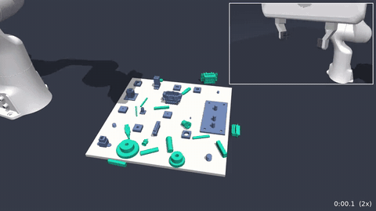

**All parts physical, three views**, 156 s: [full video](docs/videos/all_parts_physical_three_views.mp4). Every part is a rigid body for the whole run and collides with the others, every fixture and the robot. 15 of 17 assembled, 13 still seated at the end: the policy perceives only its own part, so it sweeps loose parts and knocks seated neighbours. Fixed camera on top, wrist camera on the hand bottom left, close-up bottom right.

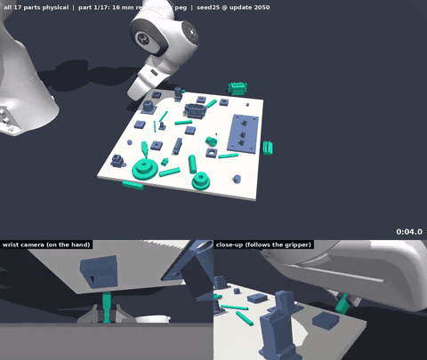

### Videos: task by task

Each clip shows the same policy from four randomized starts of the task, one each from the loose, pick-up, in-hand and
near-target reset families, chosen as successes out of 15 random bank starts (see [the report](docs/campaign_2026-11.md#demonstrations)).

| | |
| --- | --- |
| **R4** 4 mm round peg: four starts seated in 1.0 to 3.1 s<br>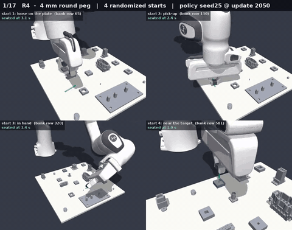 | **R8** 8 mm round peg: four starts seated in 1.0 to 2.4 s<br>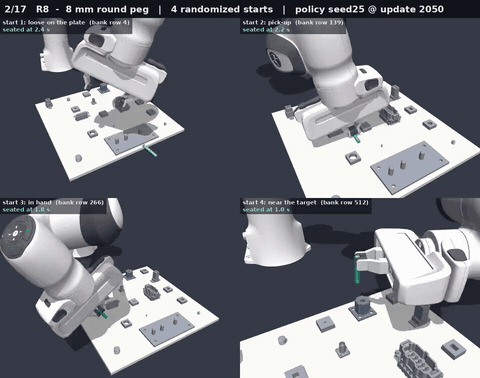 |
| **R12** 12 mm round peg: four starts seated in 1.7 to 6.4 s<br>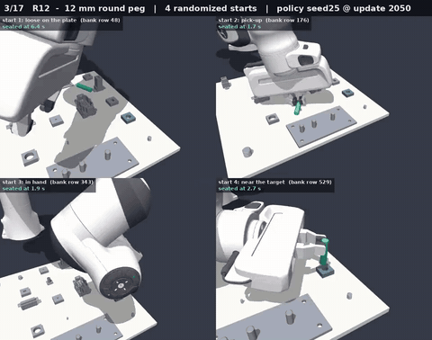 | **R16** 16 mm round peg: four starts seated in 0.4 to 3.0 s<br>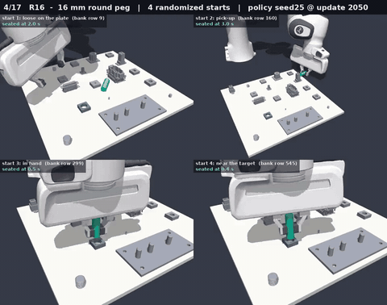 |
| **P4** 4 mm square peg: four starts seated in 0.2 to 2.2 s<br>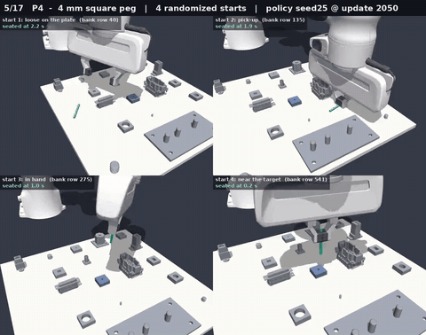 | **P8** 8 mm square peg: four starts seated in 0.1 to 4.3 s<br>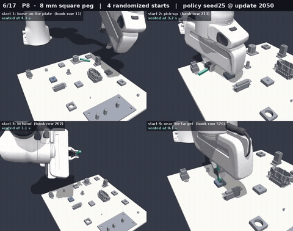 |
| **P12** 12 mm square peg: four starts seated in 0.6 to 5.2 s<br>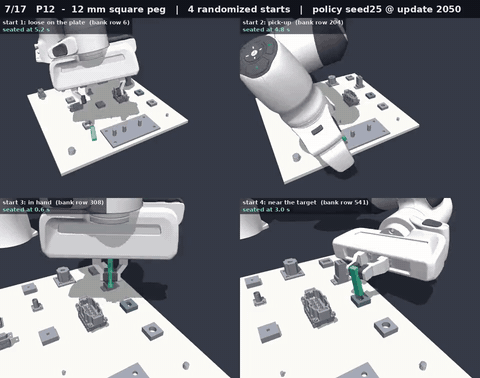 | **P16** 16 mm square peg: four starts seated in 0.6 to 3.3 s<br>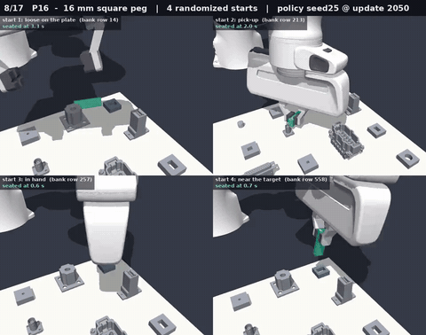 |
| **Gs** small gear: four starts seated in 0.8 to 3.6 s<br>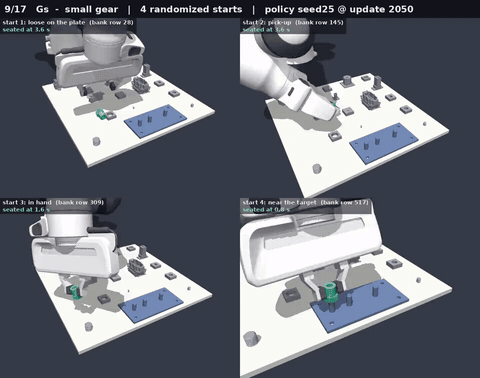 | **Gm** medium gear: four starts seated in 0.5 to 4.8 s<br>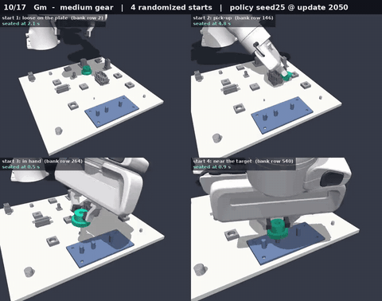 |
| **Gl** large gear: four starts seated in 1.0 to 3.0 s<br>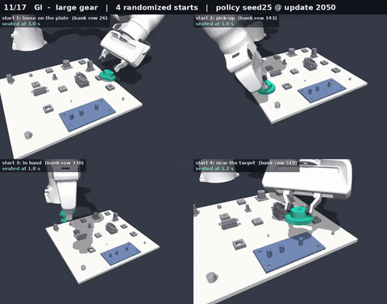 | **N8** M8 nut on bolt: four starts seated in 9.1 to 12.6 s<br>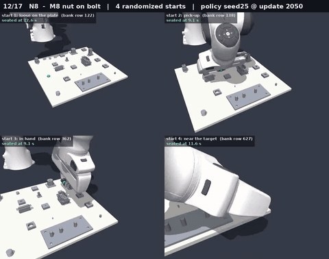 |
| **BNC** BNC connector: four starts seated in 0.5 to 4.2 s<br>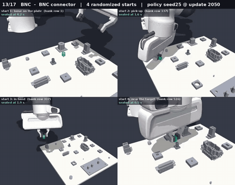 | **DSUB** D-sub connector: four starts seated in 1.9 to 5.2 s<br>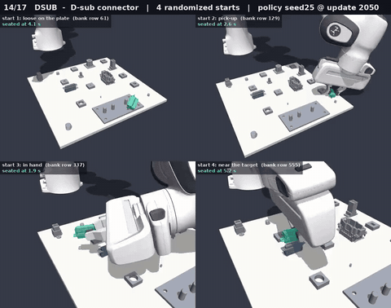 |
| **RJ45** RJ45 connector: four starts seated in 0.4 to 2.0 s<br>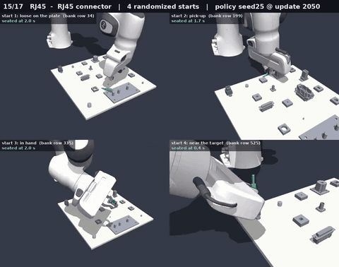 | **USB** USB connector: four starts seated in 0.7 to 8.3 s<br>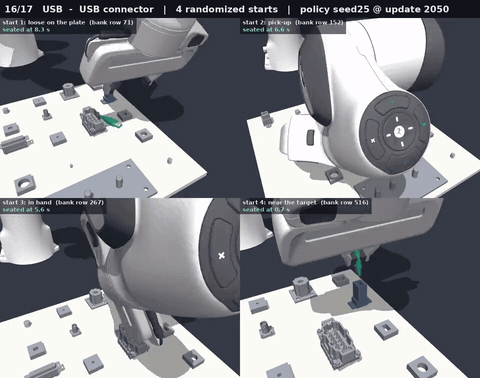 |
| **WP** waterproof connector: four starts seated in 1.4 to 4.8 s<br>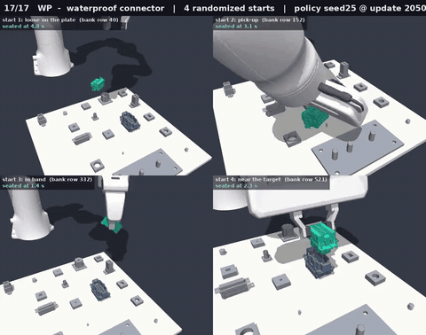 |  |

## Quick start: learning core

```bash
python3.12 -m venv .venv
source .venv/bin/activate
python -m pip install --upgrade pip
python -m pip install -e '.[test]'
python -m isaac.assembly_rl.train --help
OMP_NUM_THREADS=1 python -m pytest -q \
  src/python/isaac/assembly_rl/policy_unit_test.py \
  src/python/isaac/assembly_rl/trainer_unit_test.py \
  src/python/isaac/assembly_rl/reset_sampling_unit_test.py \
  src/python/isaac/assembly_rl/halving_unit_test.py \
  src/python/isaac/assembly_rl/geometry_unit_test.py
```

These checks cover policy/PPO behavior, reset sampling, geometry, checkpoint/resume, and frozen evaluation using small synthetic environments. They do not run robot physics or establish convergence. See [setup](docs/setup.md) before running a simulator command.

## Code map

| Module in `src/python/isaac/assembly_rl/` | Purpose |
| --- | --- |
| `policy.py` | Point encoder, residual actor/critic, normalization, PPO/GAE |
| `train.py` | Rollouts, distributed updates, checkpoints, held-out evaluation |
| `reset_sampling.py` | Reset representation and success-guided sampling, `coverage()` starvation diagnostic |
| `halving.py` | Successive halving over seeds from held-out evaluations, with the straggler rule |
| `reset_bank_builder.py`, `merge_reset_banks.py` | Physics validation and balanced bank assembly |
| `environment.py`, `model.py`, `physics_step.py` | UR7e task physics and control |
| `prepare_*`, `collision_*` | Source geometry and collision preparation |
| `preview.py` | Recorded-state export and rendering |

No CAD meshes, reset-bank data, checkpoints, credentials, infrastructure configuration, or production logs are included. Project-specific source is published for inspection without a blanket license grant; see [LICENSE](LICENSE) and [third-party notices](NOTICE).

## Citation

GitHub shows a "Cite this repository" button from [CITATION.cff](CITATION.cff). Please cite the original paper when using the method, and acknowledge this repository separately when using this implementation. The paper's results belong to its authors.

```bibtex
@article{zhang2026alphanist,
  title   = {{AlphaNIST}: Emergent Assembly Skills from Binary Task Rewards},
  author  = {Zhang, Octi and Akinola, Iretiayo and Scalise, Rosario and
             Guaman Castro, Mateo and Yin, Patrick and Widmer, Tobias and
             Macklin, Miles and Amevor, Chris and Turpin, Dylan and
             Van Gelder, Dirk and Carius, Jan and Handa, Ankur and
             State, Gavriel and Guo, Yunrong and Narang, Yashraj},
  year    = {2026},
  journal = {arXiv preprint arXiv:2610.13354},
  doi     = {10.48550/arXiv.2610.13354},
  url     = {https://arxiv.org/abs/2610.13354}
}
```
