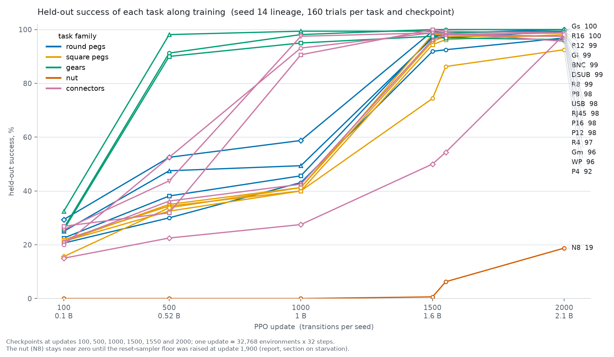
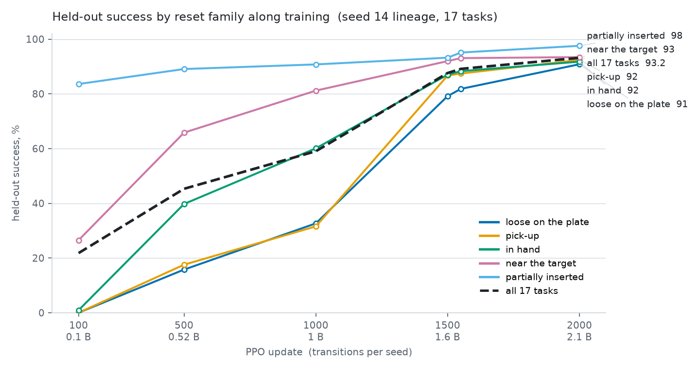
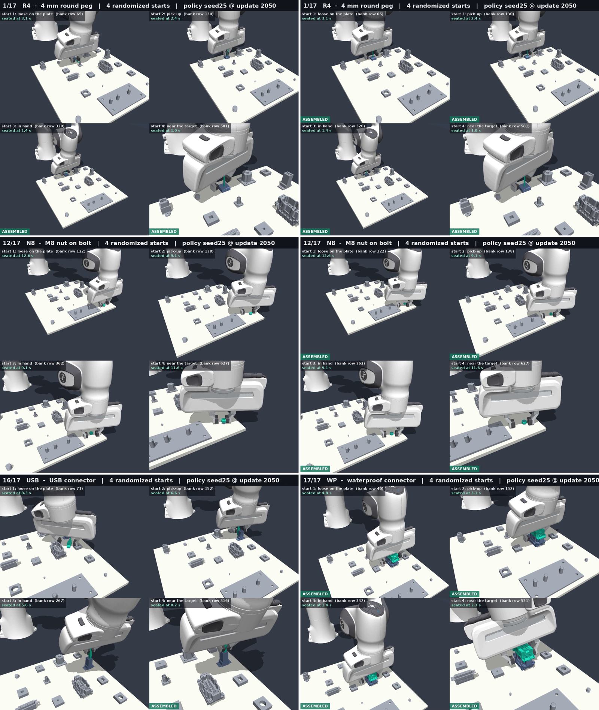
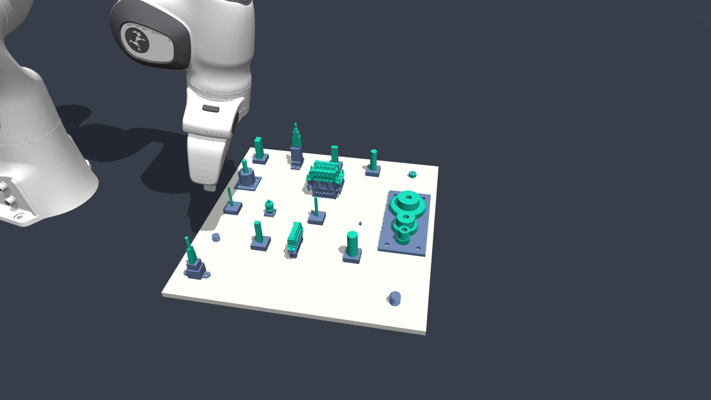
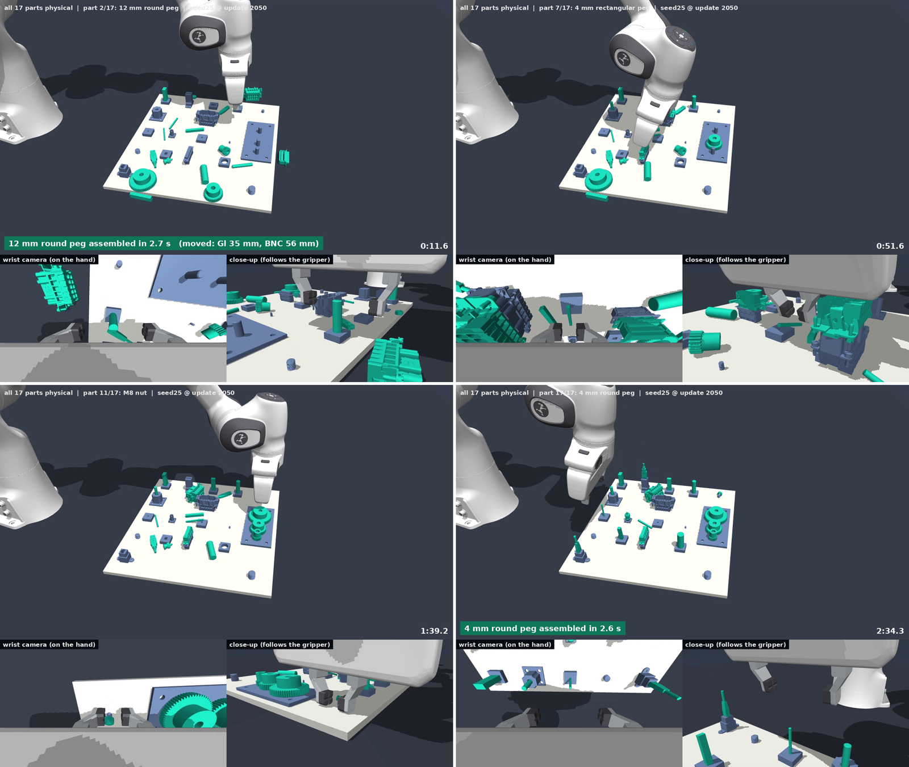

# NIST Task Board 1 campaign (November 2026)

A multi-seed training campaign of the method on the NIST Assembly Task Board 1 with a Franka Panda in CPU MuJoCo,
run with our own training, evaluation and render tooling. It is the source of the trainer's sampler floor, the
`coverage()` diagnostic, the successive-halving decider and the evaluation protocol in this repository. Numbers below
are from the campaign's held-out evaluations unless marked as training logs.

## Setup

| item | value |
| --- | --- |
| robot, physics | Franka Panda, MuJoCo 3.16 CPU, 2.5 ms step (0.5 ms for gears and the nut), GJK/EPA `ccd_iterations` 50 |
| tasks | 17 of the 20 board tasks: round pegs R4 R8 R12 R16, square pegs P4 P8 P12 P16, gears Gs Gm Gl, M8 nut N8, connectors BNC DSUB RJ45 USB WP |
| policy, action | one shared policy over all tasks, point-cloud observation, 25 Hz relative joint targets + gripper command, 15 s horizon, sparse terminal reward minus control cost, 1 mm success threshold |
| PPO | 32,768 envs x 32 steps per update, 5 epochs x 16 minibatches, Adam 1e-4 with adaptive KL 0.01 |
| reset sampling | success-guided over the union bank, 5 reset families x 640 states per task (loose on the plate, pick-up, in-hand, near the target, partially inserted), weight epsilon + sqrt(p (1 - p)) over the last 50 outcomes |
| compute | 16 seeds on two hosts (2 x 384-core AMD EPYC, 8 x RTX PRO 6000 each), one GPU per seed, physics on 48 threads per seed; 137k transitions/s in total at peak, 30 updates per hour per seed |
| evaluation | held-out panel of 3,200 trials per checkpoint: 20 tasks x 5 reset families x 32 states, 5 seeds; score = success on the 17 trained tasks (2,720 trials); milestones 100, 500, 1000, then every 500 |

Update 2000 corresponds to 2.1 billion transitions per seed, about 61 hours of wall clock for the original seeds.

## Progression of the held-out success

Every evaluated checkpoint of every seed, with per-task and per-family numbers: [`campaign_evals.csv`](campaign_evals.csv)
(71 evaluations, 29 seeds). The tables below are the seed 14 lineage rows of that file.

### By reset family

Seed 14, the original seed whose lineage won the halving, and the best seed at each milestone. All numbers are over the
17 trained tasks.

| update | seeds evaluated | median 17-task | seed 14: 17-task | loose | pick-up | in-hand | near target | partial | N8 | P4 |
| --- | --- | --- | --- | --- | --- | --- | --- | --- | --- | --- |
| 100 | 16 | 20.4 | 21.8 | 0.0 | 0.0 | 0.9 | 26.5 | 83.6 | 0.0 | 21.2 |
| 500 | 16 | 39.7 | 45.3 | 15.8 | 17.6 | 39.7 | 65.8 | 89.1 | 0.0 | 32.5 |
| 1000 | 16 | 53.9 | 59.0 | 32.6 | 31.6 | 60.1 | 81.2 | 90.8 | 0.0 | 40.0 |
| 1500 | 8 | 70.5 | 87.6 | 79.2 | 86.7 | 87.0 | 92.0 | 93.2 | 0.6 | 74.4 |
| 1550 | 1 | 89.1 | 89.1 | 81.8 | 87.4 | 88.3 | 93.1 | 95.1 | 6.2 | 86.2 |
| 2000 | 14 | 93.6 | 93.2 | 90.8 | 92.4 | 91.8 | 93.4 | 97.5 | 18.8 | 92.5 |
| 2000, best (seed 25) | | | 94.3 | 92.9 | 94.0 | 92.7 | 93.2 | 98.9 | 26.9 | 95.6 |

The families converge in the order of their difficulty: partially inserted starts are solved almost from the start,
near-target starts by update 1000, the three hard families (loose, pick-up, in-hand) climb from 0 to 90 % between
updates 100 and 2000. The one task that does not follow is the nut (N8), see below.

### Training-logged success is not a measure of the policy

The learner logs success on the starts the sampler drew, not on a fixed panel. Seed 14's log reads 54 % at update 1
and 80 % at update 100, when the held-out panel scored 22 %, because the sampler draws easy, partially inserted starts
first. Late in training the same number falls (95 % at update 2000, 87 % at 2169) while the policy improves, because the
sampler has moved to the hardest unsolved rows. Judge only on the held-out panel, per family.

| update (seed 14, training log) | 1 | 100 | 500 | 1000 | 1500 | 2000 | 2169 |
| --- | --- | --- | --- | --- | --- | --- | --- |
| logged success | 53.8 | 79.3 | 83.6 | 87.0 | 91.3 | 95.0 | 86.9 |
| loose / pick-up / in-hand | 0 / 0 / 1 | 0 / 12 / 53 | 80 / 80 / 82 | 81 / 83 / 89 | 90 / 91 / 93 | 95 / 95 / 95 | 90 / 89 / 84 |
| near / partial | 9 / 88 | 73 / 88 | 84 / 89 | 89 / 91 | 93 / 90 | 93 / 93 | 78 / 81 |
| held-out 17-task | | 21.8 | 45.3 | 59.0 | 87.6 | 93.2 | |

## Results at update 2000

17-task held-out success of every seed evaluated at update 2000. Seeds 16 to 23 are forks of seed 14 at update 1550;
seeds 24 to 28 are forks of seed 14 at updates 1900 to 1950 with a larger sampler floor (epsilon 0.01, 0.03, 0.1).

| seed | 14 | 16 | 17 | 18 | 19 | 20 | 21 | 22 | 23 | 24 | 25 | 26 | 27 | 28 |
| --- | --- | --- | --- | --- | --- | --- | --- | --- | --- | --- | --- | --- | --- | --- |
| 17 tasks | 93.2 | 93.5 | 93.6 | 93.6 | 93.8 | 93.7 | 93.5 | 93.5 | 93.6 | 93.7 | **94.3** | 94.2 | 93.6 | 93.6 |
| 16 tasks without N8 | 97.8 | 97.8 | 98.3 | 98.3 | 98.4 | 98.4 | 97.9 | 98.2 | 98.2 | 98.2 | **98.5** | 98.2 | 98.1 | 98.1 |
| N8 | 18.8 | 24.4 | 19.4 | 18.8 | 19.4 | 18.8 | 21.9 | 18.8 | 20.0 | 21.2 | 26.9 | 30.0 | 21.2 | 21.2 |

Per task at update 2000, leader seed 25 and the range over the 14 seeds (160 trials per task per seed, one failure is
0.6 points):

| task | R4 | R8 | R12 | R16 | P4 | P8 | P12 | P16 | Gs | Gm | Gl | N8 | BNC | DSUB | RJ45 | USB | WP |
| --- | --- | --- | --- | --- | --- | --- | --- | --- | --- | --- | --- | --- | --- | --- | --- | --- | --- |
| seed 25 | 98.8 | 100 | 99.4 | 98.8 | 95.6 | 98.8 | 98.8 | 99.4 | 98.8 | 96.2 | 99.4 | 26.9 | 98.8 | 98.8 | 96.9 | 98.1 | 100 |
| 14 seeds, mean | 97.4 | 98.8 | 99.0 | 99.0 | 95.4 | 97.6 | 98.3 | 98.8 | 99.4 | 96.9 | 98.8 | 21.0 | 98.8 | 98.9 | 97.6 | 97.5 | 98.8 |
| 14 seeds, min | 95.6 | 96.9 | 97.5 | 98.1 | 92.5 | 96.9 | 96.2 | 97.5 | 98.1 | 94.4 | 97.5 | 18.8 | 97.5 | 96.9 | 95.0 | 95.0 | 95.6 |

Per reset family at update 2000 over the 17 tasks (seed 25): loose 92.9, pick-up 94.0, in-hand 92.7, near target 93.2,
partially inserted 98.9. Each family average is pulled down about 5 points by N8 alone.

N8 by start family at update 2000 (160 trials per family per seed): every seed threads the nut from partially
inserted starts (83 to 91 %) and, until the sampler floor was raised, from no other family (0 to 3 %). Seeds 25 and 26,
100 updates after the floor change, are the first to thread it from loose (19 and 23 %), pick-up (14 %), in-hand (13 %)
and near-target (6 and 18 %) starts.

The paper's threshold of 98.4 % is met on the 16 tasks without the nut by three seeds; on 17 tasks the gap is the nut.

## Finding: the reset sampler starves never-solved starts

The sampling weight epsilon + sqrt(p (1 - p)) is epsilon for every row the policy has never solved (p = 0) and for every
row it always solves (p = 1). With the paper's epsilon of 1e-4 that is about 3,000 times less than a frontier row at
p = 0.5. Read from seed 14's sampler state at update 2000:

| rows | share of rows | share of draws |
| --- | --- | --- |
| always solved (p = 1) | 78.9 % | 1.2 % |
| never solved (p = 0) | 17.5 % | 0.3 % |
| frontier | 2.9 % | 98.6 % |

Effective number of rows drawn: 1,420 of 54,400. Each unthreaded N8 start had been drawn about 5 times in 1,900 updates
(0.1 % of all draws); the "N8 82 %" in the training log was measured on nearly seated partial starts. A policy that
is never shown a start cannot learn it, and a policy that drifts on a mastered start is never re-measured.

Fix: forks of the leader with epsilon 0.01, 0.03 and 0.1 (12.6, 17.7 and 20.6 % of draws reach p = 0 rows from the
same state; uniform sampling would give 22.1 %). After 50 updates the number of unthreaded N8 rows with at least one
success went from 1 to 5 per family to 16 to 63 per family; after 100 updates the first held-out successes from loose,
pick-up, in-hand and near starts appeared (table above). Side effect: once a few never-solved rows get their first
success their weight jumps from epsilon to the frontier value and the sampler floods them, so episode length and
physics cost rise (the nut's failing episodes run the full horizon with thread contact) and throughput fell from 137k
to 74k transitions/s across the whole lineage while the nut was being learned. The default in this repository is
therefore epsilon 1e-2, and `SuccessGuidedSampler.coverage()` reports the row and draw shares above so the effect is
visible in logs.

## Successive halving with a straggler rule

Sixteen seeds started; at update 1000 the eight seeds clearly below the leader on the held-out panel were stopped and
their slots given to forks of the leader's newest checkpoint; at updates 1900 to 2000 six more were replaced by the
sampler-floor forks. The decision rule is `halving.decide`: score = 17-task held-out success; leader = best; stop at most
half, only seeds whose gap to the leader exceeds 1.96 standard errors; the leader, the best seed of the best other
lineage and seeds under a protection grace are never stopped; forks come from the leader's newest verified checkpoint.

Seeds that learn the hard rows run slower (half the updates per hour of the others), so a round that waits for every
seed's evaluation at milestone M waits for the slowest. `halving.gate` lets the round run once any seed is 250 updates
past M; the missing seeds cannot lead, are judged against the leader at the newest milestone both have an evaluation
for, and are protected when they are the only seed of their lineage (`halving_unit_test.py`).

## Demonstrations

Videos: `../docs/videos/` holds the three full runs (four starts per task, one board sequential, all parts physical) and
`../docs/gifs/` one clip per task; they are embedded in the [README](../README.md#videos-combined-runs).

Seed 25 at update 2050 on four randomized successful starts per task, one from each reset family where available (15
candidate starts per task, 249 of 255 succeeded; N8 from loose, pick-up, in-hand and near starts in 9 to 13 s).

All 17 parts on one board, assembled one after another by the same policy without a world reset, the robot state
carried over between parts: 17 of 17 seated, 1.5 to 7 s each, the nut 17.9 s. In this run only the active part is
physical; the others are drawn at their resting or assembled poses.

Same run with every part a rigid body for the whole episode (parts collide with each other, every fixture and the
robot; one 0.5 ms step for all): 15 of 17 assembled, 13 still seated at the end. The policy observes only its own part,
so loose parts in the swing path get swept (the BNC plug off the board in stage 2), a seated connector was unplugged by
the hand while inserting a neighbour, and the two weakest tasks, P4 and N8, failed inside their 30 s budget with
clutter around them. Views: fixed scene camera, wrist camera on the hand, close-up following the gripper.

## What we learned

- Judge on a fixed held-out panel per reset family; the training log measures the sampler, not the policy.
- A success-guided sampler with a tiny floor starves never-solved starts and never re-measures mastered ones; use a floor
  around 1e-2 and log where the draws go.
- Expect throughput to fall when the sampler reaches a contact-heavy task; that is the curriculum working, not a fault.
- Halve seeds on held-out evaluations at fixed updates, never on wall clock, and do not let the slowest seed gate the
  round.
- Keep every physics option that changes contacts in a recorded identity (step, solver iterations, collision budgets) and
  evaluate under exactly one of them; a GJK/EPA budget of 35 was too small for the fine nut threads and had to be raised
  to 50 before the campaign.
- A policy that only perceives its own part will knock the others; multi-part scenes need either perception of the
  clutter or a planner above the policy.
